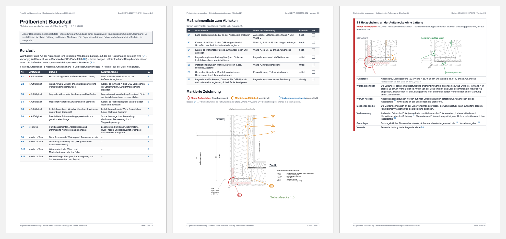
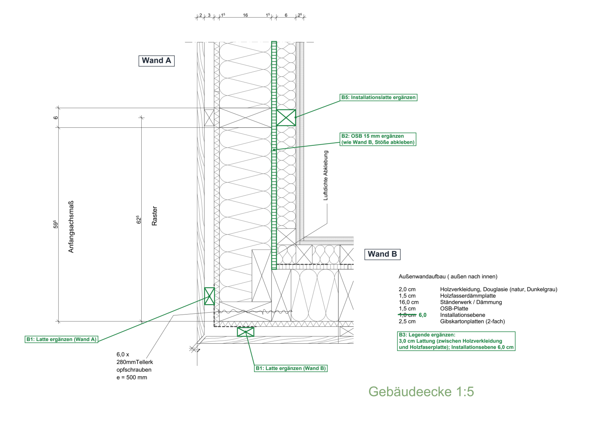

# Detailprüfer Architektur

**Ein Claude-Skill, der Holzbau-Detailzeichnungen (PDF) qualitativ nach deutschen Regeln
prüft, die Befunde farbig in der Zeichnung markiert, Korrekturen grün einzeichnet und einen
PDF-Prüfbericht mit Maßnahmenliste und Quellen erstellt.**

Entstanden in der WPK *Vibecoding KI-Werkstatt* an der Jade Hochschule (16.–20.11.2026).

> ⚠️ **Hilfestellung, keine Prüfung.** Der Detailprüfer ersetzt keine fachliche Prüfung
> und keinen Nachweis. Die KI kann sich irren, deshalb müssen alle Ergebnisse fachlich
> überprüft werden. Dieser Hinweis steht auch in jedem Bericht.

---

## Warum?

Beim Zeichnen eines Details kennt man meist den **ungefähren Aufbau**: welche Schichten in
Wand und Dach gehören und in welcher Reihenfolge. Unsicher wird es an einzelnen Punkten, vor
allem an den **Anschlüssen**. Wo endet die Dampfbremse? Wie läuft die Dämmung über den
Wandkopf? Wie wird die Unterdeckung in die Rinne geführt? Den genauen Aufbau kennt man dort
oft nicht.

Der Detailprüfer kontrolliert deshalb das **gesamte Detail**: jede Schicht, jedes Bauteil
und jeden Anschluss. Er gibt eine **Zweitmeinung** und prüft, ob das Detail **technisch
korrekt** ist. Er richtet sich an Architekturstudierende und perspektivisch auch an
Planungsbüros.

## Was der Skill macht

1. **Zeichnung lesen:** Legende, Maße, Höhenkoten und Beschriftungen werden exakt aus der
   PDF gelesen (nicht aus dem Bild geraten). Daraus entstehen eine Prüfsumme der Datei,
   die Detailart (z. B. Traufe, First, Sockel) und das Tragsystem.
2. **Bauteil-Check:** Jede Schicht und jedes Pflichtbauteil der Detailart wird einzeln
   abgehakt. Dabei wird gefragt: vorhanden? in allen Abschnitten? Dicke üblich? Material
   angegeben? Schraffur passend?
3. **Rückfragen**, aber nur dann, wenn ohne die Antwort ein Befund nicht beurteilbar wäre.
4. **Prüfung** gegen einen Katalog von rund 45 Regeln. Jede Regel ist mit einer Quelle belegt.
5. **PDF-Prüfbericht** mit markierter Zeichnung und grüner Korrekturskizze.


*Beispielbericht Gebäudeecke Außenwand (Holzrahmenbau, Blindtest): Kurzfazit mit
Befundliste, Maßnahmenliste mit markierter Zeichnung und eine Befundkarte mit Ist-Zustand und
Korrektur nebeneinander.*


*Korrekturskizze der Gebäudeecke als Ganzes. Grün eingezeichnet sind die Latten an der
Außenecke in beiden Wänden (B1), die OSB-Platte in Wand A (B2), die korrigierte Legende (B3)
und die Installationslatte (B5).*

## Was im Bericht steht

- **Seite 1:** Datei, Prüfsumme und Skill-Version, Kurzfazit, Befundliste mit Seitenverweisen
- **Maßnahmenliste zum Abhaken**, nach Priorität sortiert
- **Markierte Zeichnung:** Kreis und Badge B1, B2 … je Befund
- **Korrekturskizze:** der korrigierte Zustand, grün eingezeichnet, zusätzlich als eigene Vektor-PDF
- **Befundkarten:** woran erkennbar, warum relevant, mögliches Risiko, Verbesserung, Grundlage
- **Schichtenaufbau** mit üblichen Dicken und Baustoff-Empfehlungen
- **Nicht Prüfbares, offene Fragen, positiv Festgestelltes**
- **Anhang:** Methode, Annahmen, Prüfprotokoll aller Regeln, Code-Legende und Quellenverzeichnis
  mit verlinkten Fußnoten

### Einstufungen

| Einstufung | Darstellung | Bedeutung |
|---|---|---|
| **Klarer Aufbaufehler** | Rot, durchgezogen | eindeutig falsch, oder ein funktional notwendiges Bauteil fehlt |
| **Mögliche Auffälligkeit** | Orange, gestrichelt | kann ein Problem sein, muss geklärt werden |
| **Verbesserungshinweis** | Blau, gepunktet | funktioniert, ist aber verbesserbar (z. B. fehlende Angabe) |
| **Aus der Datei nicht prüfbar** | keine Markierung | nur mit Nachweis oder weiteren Unterlagen beurteilbar |

Jeder Befund bekommt außerdem eine **Aussagesicherheit** (hoch / mittel / gering).

## Was geprüft wird

| Bereich | Regeln | Beispiele |
|---|---|---|
| Luftdichtheit | LD-01 … 06 | durchgehende Ebene, Anschlüsse, Installationsebene |
| Feuchteschutz | FS-01 … 05 | Schichtenfolge innen dampfbremsend, außen diffusionsoffen |
| Wärmeschutz / Wärmebrücken | WB-01 … 04 | lückenlose Dämmung, Dämmung in voller Schichtdicke |
| Winddichtheit, Hinterlüftung, Schlagregen | WH-01 … 07 | Zu- und Abluft, Insektenschutz, Unterdeckung |
| Holzschutz | HS-01 … 03 | baulicher Holzschutz, Spritzwasser |
| Konstruktion | KO-01 … 09 | Auflager, Unterkonstruktion an Ecken, Schichten enden am Anschluss, **jede Schicht in allen Abschnitten**, **Zusatzhölzer nach Funktion** |
| Zeichnungsqualität | ZQ-01 … 06 | Legende passt zur Zeichnung, Maßketten, Hinweislinien, Rechtschreibung |
| Steildach | DA-01 … 06 | Tragsystem, First, Traufe, Ortgang, Lattung |
| Wand und Sockel | SO-01 … 04 | Schichtenfolge, Spritzwasserabstand, Schwelle, Bodenaufbau |
| Bauteildicken, Baustoffe | RW-01, BS-01 | übliche Dicken als Praxis-Richtwert, geeignete Baustoffe |
| Detail-Datenbank | DT-00 ff. | First, Traufe, Ortgang, Sockel, Wandecke, Fenster, Flachdach, Pultdach – mit eigenen Referenzskizzen |

**Maßstab sind deutsche Normen und Regelwerke**, u. a. DIN 4108, DIN 68800, das GModG
(vormals GEG), die Fachregeln des Zimmerer- und Dachdeckerhandwerks, dataholz.eu und
BauNetz Wissen. Normausgaben und ihr Stand sind in
[`skill/pruefkatalog/quellen.md`](skill/pruefkatalog/quellen.md) dokumentiert, alle
Quellen mit Link in [`quellen.json`](skill/pruefkatalog/quellen.json). Die Regeln sind in
eigenen Worten formuliert. Normtexte und fremde Zeichnungen werden nicht kopiert, sondern
nur verlinkt.

## So benutzt du den Skill

### In claude.ai (ohne Programmierkenntnisse)

Voraussetzung ist ein Claude-Abo (z. B. Pro). Ein API-Key ist nicht nötig.

1. In den Einstellungen von claude.ai die **Code-Ausführung** einschalten.
2. Den Skill als Datei vorbereiten:
   - Repository herunterladen (grüner Button **Code → Download ZIP**) und entpacken.
   - Den Ordner `skill` kopieren und die Kopie in **`detailpruefer-architektur`** umbenennen.
   - Diesen Ordner als ZIP packen (Windows: Rechtsklick → *Senden an* → *ZIP-komprimierter
     Ordner*). Im ZIP muss der Ordner `detailpruefer-architektur` mit der Datei `SKILL.md`
     liegen.
3. In claude.ai **Plugins → Hinzufügen → Plugin hochladen** wählen und die ZIP-Datei
   hochladen. Für ein Update später **⋯ → Neue Version hochladen** wählen.
4. Einen **neuen Chat** öffnen, die Detailzeichnung als **PDF** hineinziehen und z. B.
   schreiben: *„Prüfe dieses Detail.“*
5. Falls der Skill Rückfragen stellt: beantworten. Danach erstellt er den Prüfbericht
   zum Herunterladen.

> Tipp: Für jede Prüfung einen **neuen Chat** verwenden. In einem alten Chat ist sonst noch
> eine frühere Skill-Version aktiv.

### In Claude Code

Den Ordner `skill` als `~/.claude/skills/detailpruefer-architektur` ablegen und die
Python-Pakete installieren:

```
pip install pypdf reportlab pypdfium2 pillow
```

Die Skripte lassen sich auch einzeln aufrufen:

```
python skill/scripts/fakten.py  <zeichnung.pdf> fakten.json
python skill/scripts/bericht.py <zeichnung.pdf> <befunde.json> <bericht.pdf>
```

## Grenzen

- **Keine Berechnungen:** keine U-, R- oder sd-Werte, kein Tauwasser, kein f_Rsi, keine
  Statik. Solche Punkte erscheinen als *„Nachweis erforderlich“*.
- **Brand- und Schallschutz** werden nicht geprüft (nur Hinweis).
- Bisher erprobt für **Holzrahmenbau**: Wand und Ecke, Traufe, First, Ortgang, Sockel. Für
  Fenster, Flachdach und Pultdach gibt es Katalogeinträge, aber noch keine Testdetails.
- Die Deutung der Zeichnung schwankt zwischen KI-Läufen. Fest sind nur die exakt aus der PDF
  gelesenen Fakten und die Entscheidungsregeln. Vergleichbar sind Berichte nur bei gleicher
  **Prüfsumme und Skill-Version**.
- Kreise und Korrekturen werden nach Koordinaten gesetzt und können leicht versetzt sein.
  Vektorgenau ist nur die separate Korrekturskizze (PDF).
- Fehlalarme kommen vor (z. B. kurze Linien in Platten als „möglicher Plattenstoß“).

## Wie getestet wurde

Der Skill wurde mit **Blindtests** entwickelt. Dafür haben wir Details mit eingebauten
Fehlern gezeichnet, die Musterlösung blieb bis nach dem Testlauf verborgen. Jeder Lauf wurde
ausgewertet (Treffer, Fehlalarme, Lehren, siehe [`tests/loesung/`](tests/loesung/)). Jeder
übersehene Fehler wurde als **allgemeine Fehlerklasse** im Katalog verankert, nicht als
Lösung für ein einzelnes Detail.

| Blindtest | Ergebnis (bester Lauf) |
|---|---|
| Gebäudeecke Außenwand | 4 von 4 Fehlern, 1 Fehlalarm mit geringer Aussagesicherheit |
| Traufe | 4 von 4 Fehlern (claude.ai, zweiter Lauf) |
| First | Firstabdeckung, Dämmung und Dampfbremse sicher erkannt; Firstpfette erst nach mehreren Nachbesserungen |
| Ortgang | 6 von 7 Fehlern |
| Sockel | 4 von 5 Fehlern; die übersehene Sauberkeitsschicht führte zur Regel KO-08 (v12) |
| Gebäudeecke (zweites Detail) | 2 von 2 Fehlern erkannt (Eckabklebung, fehlender Eckstiel); der Eckstiel wurde aber an falscher Stelle eingezeichnet, daraus entstand die Regel KO-09 (v13) |

### Aus Fehlern gelernt: Prinzipien statt Musterlösungen

Wenn der Skill etwas übersieht oder falsch einzeichnet, wird **nicht** die Musterlösung in den
Skill kopiert. Stattdessen wird das **Prinzip dahinter** als Regel formuliert, die für jedes
Detail gilt. Zwei Beispiele aus den letzten Versionen:

- **Jede Schicht in allen Abschnitten (KO-08, v12):** Beim Sockel lag die Sauberkeitsschicht
  nur unter dem Fundament, unter der Bodenplatte fehlte sie. Weil die Beschriftung auf das
  Fundament zeigte, hielt der Skill die Schicht für vorhanden. Neue Regel: **Eine Beschriftung
  belegt eine Schicht nur an der Spitze ihrer Hinweislinie.** Der Skill listet für jede Schicht
  alle Abschnitte auf, in denen sie liegen muss, und prüft jeden einzeln. Das gilt ebenso für
  Abdichtung, Dämmung, Trennlagen und Bahnen. Eine Schichtenfolge wird erst nach diesem Check
  als „vollständig“ gewertet.
- **Zusatzhölzer nach Funktion (KO-09, v13):** An der Wandecke hat der Skill den fehlenden
  Eckstiel erkannt, ihn aber oberhalb der Ecke und durch die ganze Dämmebene gezeichnet. Neue
  Regel: Für jedes Zusatzholz beantwortet der Skill vier Fragen.
  1. **Wozu dient es?** Welchen Plattenrand trägt es, welches Bauteil schließt es an?
  2. **Wo ist diese Funktion?** Das Holz liegt direkt hinter dem Plattenrand und berührt das
     Bauteil, das es anschließt.
  3. **Wie klein geht es?** Nur so groß wie nötig. Die Dämmung läuft auf der Gegenseite weiter,
     damit keine unnötige Wärmebrücke entsteht.
  4. **Ist schon Holz da?** Dann wird das vorhandene genutzt.

  Nach dem Zeichnen kontrolliert der Skill das im Bild. Dazu kam eine eigene Referenzskizze für
  die Außenecke. Die Regel gilt für alle Zusatzhölzer: an Ecken, Wandanschlüssen, Laibungen,
  Decken und Plattenstößen.

### Versionsstand

| Version | Neu |
|---|---|
| v11 | Fakten (Maße, Legende, Winkel, Texte) werden exakt aus der PDF gelesen; Prüfsumme und Skill-Version im Bericht; Prüfprotokoll aller Regeln |
| v12 | KO-08: jede Schicht in allen Abschnitten; fehlende Sauberkeitsschicht = klarer Aufbaufehler |
| v13 | KO-09: Zusatzhölzer nach Funktion platzieren; Referenzskizze Außenecke |

Der aktuelle Stand steht in [`skill/VERSION`](skill/VERSION) und auf Seite 1 jedes Berichts.

## Projektaufbau

```
detailpruefer-architektur/
├─ skill/                  ← der eigentliche Skill (wird als ZIP hochgeladen)
│  ├─ SKILL.md             Hauptanweisung: Grundsätze, Ablauf, Format der Befunde
│  ├─ VERSION              Skill-Version (steht im Bericht)
│  ├─ checkliste.md        Rückfragen (nur konstruktiv relevante)
│  ├─ pruefkatalog/        Prüfregeln 00–12, Quellen
│  ├─ referenz/            eigene Referenzskizzen je Detailtyp
│  └─ scripts/             Python: fakten, raster, linien, markieren, skizze, bericht
├─ tests/                  Testdetails, Befundlisten, Musterlösungen und Auswertungen
├─ beispiel/               Beispielberichte (Stand 17.11.)
├─ docs/                   Bilder für diese README
├─ PLAN.md                 Plan, Entscheidungen und Entwicklungsstand
├─ CLAUDE.md               Regeln für die Zusammenarbeit mit dem KI-Agenten
└─ HANDOFF.md              Übergabe zwischen Arbeitssitzungen
```

## KI-Kennzeichnung

Dieses Projekt ist mit KI entstanden (*Vibecoding*). Code, Prüfkatalog-Texte und diese README
hat **Claude Code (Anthropic)** nach Vorgaben und fachlichen Entscheidungen des Autors
geschrieben. Fachliche Inhalte, Einstufungen, Testdetails und Musterlösungen stammen vom
Autor, der als Architekturstudent der fachliche Experte im Projekt ist. Quellen wurden per
Web-Recherche ermittelt und verlinkt. Die erzeugten Prüfberichte sind ebenfalls KI-Ergebnisse
und als solche gekennzeichnet.
